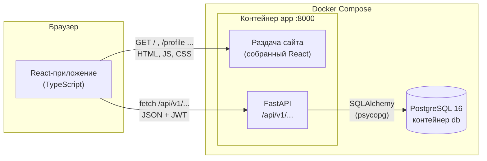
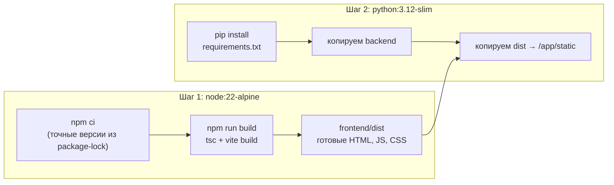
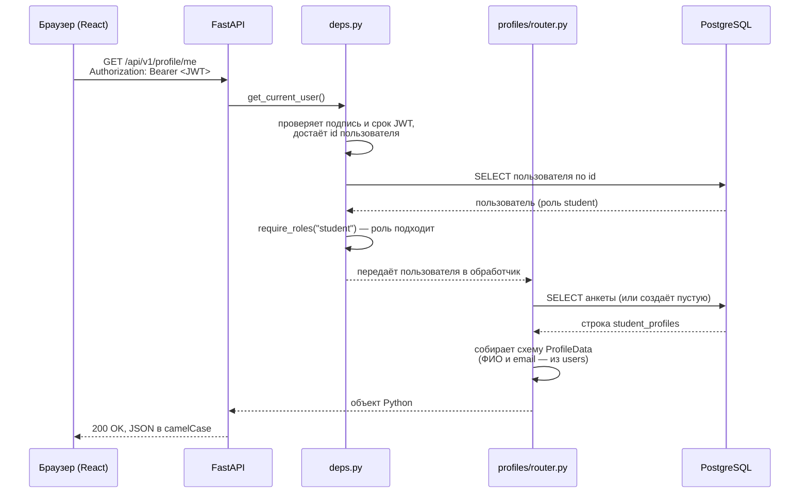
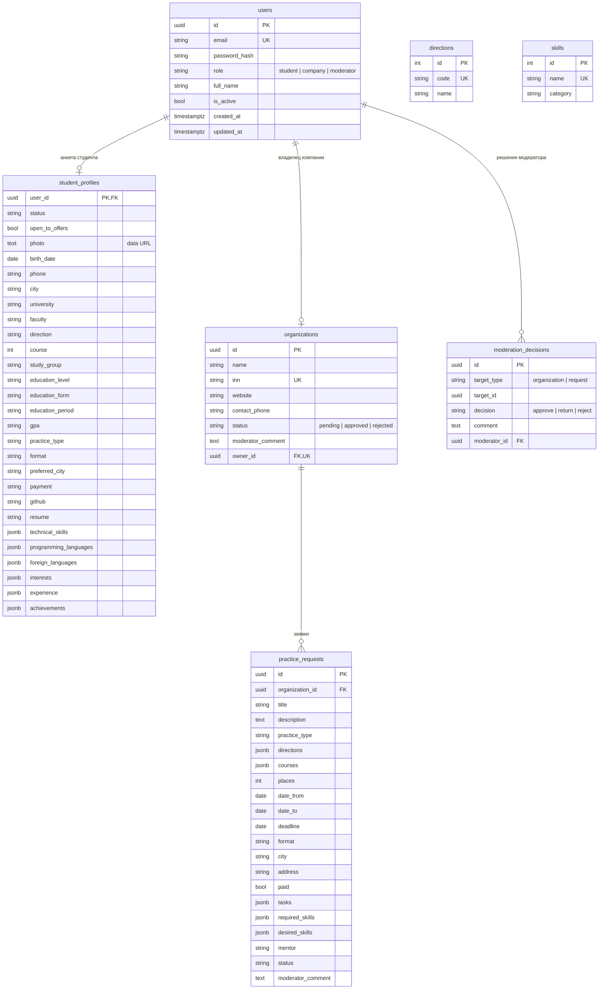
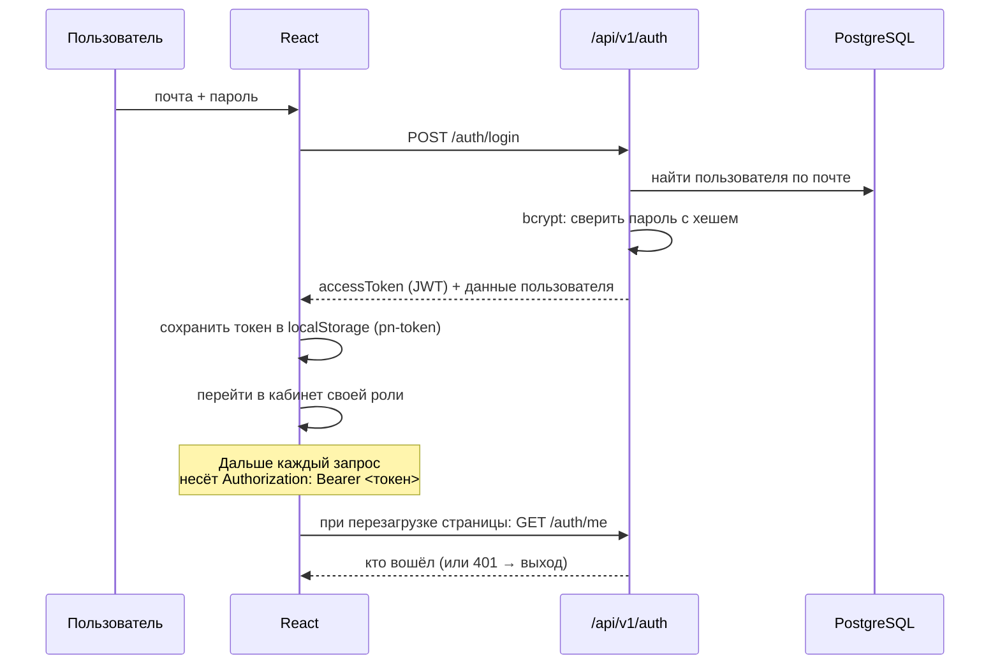
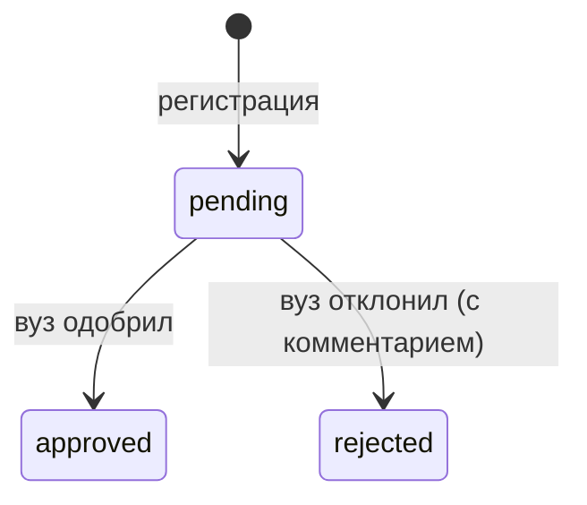
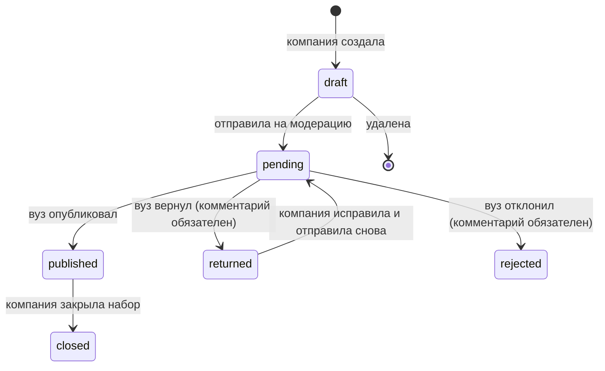
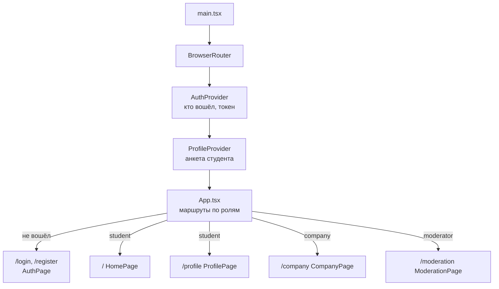

# Архитектура Practice.Navigator

Документ описывает, как устроен сервис на конец спринта 2: из чего он состоит, как проходит каждый запрос, где лежат данные и почему выбрано именно такое решение. Диаграммы написаны на Mermaid — GitHub показывает их картинками прямо на странице.

**Команда Synapse:** Галимова Алина, Комарова Маргарита (backend), Березовская Галина (data analyst), Лавринович Елизавета, Конева Дарья (frontend).

---

## Содержание

1. [Что делает сервис](#1-что-делает-сервис)
2. [Общая схема](#2-общая-схема)
3. [Технологии и почему они](#3-технологии-и-почему-они)
4. [Структура репозитория](#4-структура-репозитория)
5. [Запуск: Docker](#5-запуск-docker)
6. [Путь одного запроса](#6-путь-одного-запроса)
7. [Backend](#7-backend)
8. [База данных](#8-база-данных)
9. [Вход, роли и права](#9-вход-роли-и-права)
10. [API: все эндпоинты](#10-api-все-эндпоинты)
11. [Жизненный цикл заявки и компании](#11-жизненный-цикл-заявки-и-компании)
12. [Frontend](#12-frontend)
13. [Расчёты на фронтенде: заполненность и совпадение](#13-расчёты-на-фронтенде-заполненность-и-совпадение)
14. [Темы и стили](#14-темы-и-стили)
15. [Тестовые данные](#15-тестовые-данные)
16. [Как вести разработку](#16-как-вести-разработку)
17. [Безопасность](#17-безопасность)
18. [Отличия от плана в презентации](#18-отличия-от-плана-в-презентации)
19. [Что дальше](#19-что-дальше)

---

## 1. Что делает сервис

Practice.Navigator соединяет три стороны производственной практики:

| Роль | Что делает в сервисе |
|---|---|
| **Студент** | Регистрируется по почте вуза, заполняет анкету-портфолио, видит опубликованные заявки с процентом совпадения |
| **Компания** | Регистрируется по ИНН, создаёт заявки на практикантов, отправляет их вузу на проверку |
| **Модератор вуза** | Проверяет новые компании, публикует, возвращает на доработку или отклоняет заявки. Отдельной роли администратора нет — она была объединена с модератором |

Главное правило из презентации: **студенты видят только то, что проверил вуз.** Компания не может отправить заявку, пока вуз не одобрил саму компанию, а заявка попадает к студентам только после модерации.

---

## 2. Общая схема



Сервис состоит из **двух контейнеров**:

- **`app`** — одно приложение FastAPI, которое отдаёт и сайт, и API. Снаружи доступен на `http://localhost:8000`.
- **`db`** — PostgreSQL 16. Данные лежат в томе Docker `pgdata`, поэтому переживают перезапуск.

Пользователь открывает **одну ссылку**. Браузер загружает React-приложение, и дальше оно общается с сервером только через JSON-запросы к `/api/v1/...`.

---

## 3. Технологии и почему они

### Backend

| Технология | Версия | Зачем | Почему именно она |
|---|---|---|---|
| **Python** | 3.12 | Язык backend | Команда знает Python; на нём же будет алгоритм подбора и аналитика Галины |
| **FastAPI** | 0.115 | Веб-фреймворк, API | Сам строит документацию `/docs` по коду; проверяет входящие данные через схемы; меньше шаблонного кода, чем в Django |
| **Pydantic** | 2 (входит в FastAPI) | Схемы и проверка данных | Описываем поле один раз — получаем и проверку, и документацию, и преобразование в JSON |
| **SQLAlchemy** | 2.0 | Работа с БД через Python-классы | Стандарт в Python; таблицы описаны классами, запросы — кодом, а не строками SQL |
| **psycopg** | 3 | Драйвер PostgreSQL | Современный официальный драйвер |
| **Alembic** | 1.14 | Миграции БД | Схема базы хранится в git по версиям: у всех одинаковые таблицы, изменения не делаются руками |
| **PyJWT** | 2.10 | Токены входа | Простой стандартный формат, не нужно хранить сессии на сервере |
| **bcrypt** | 4.2 | Хеширование паролей | Медленный по замыслу алгоритм: перебор паролей из утёкшей базы становится очень долгим |
| **pydantic-settings** | 2.6 | Настройки из переменных окружения | Один и тот же код работает локально и на сервере, меняются только переменные |
| **uvicorn** | 0.34 | Сервер, который запускает FastAPI | Стандартный ASGI-сервер для FastAPI |

### Frontend

| Технология | Версия | Зачем | Почему именно она |
|---|---|---|---|
| **React** | 18 | Интерфейс из компонентов | Заявлен в презентации; самый распространённый, проще найти ответы и примеры |
| **TypeScript** | 5.6 | Типы в JavaScript | Ошибки вида «опечатка в поле» ловятся до запуска; типы данных совпадают со схемами backend |
| **Vite** | 5 | Сборка и сервер разработки | Запускается за секунды, страница обновляется сразу при сохранении файла |
| **React Router** | 6 | Переходы между страницами | Адреса `/profile`, `/company` работают как обычные ссылки, кнопка «Назад» в браузере работает |
| **lucide-react** | 0.460 | Иконки | Аккуратные линейные иконки как в макете; подключаются по одной, лишнее не попадает в сборку |
| **Обычный CSS** | — | Стили | Темы сделаны через CSS-переменные; не нужен отдельный UI-фреймворк, всё под контролем команды |

### Инфраструктура

| Технология | Зачем | Почему |
|---|---|---|
| **Docker + Docker Compose** | Запуск всего проекта одной командой | У всех пятерых одинаковое окружение, не нужно ставить Python и PostgreSQL вручную |
| **PostgreSQL 16** | База данных | Надёжная, бесплатная, умеет JSONB (см. раздел 8), заявлена в презентации |
| **Git + GitHub** | Код и история | Одна ветка `main`, метки на конец спринтов (см. раздел 16) |

---

## 4. Структура репозитория

```
Practice.Navigator/
├── Dockerfile                 Сборка образа: сначала React, потом Python
├── docker-compose.yml         Два контейнера: app и db
├── .dockerignore              Что не копировать в образ (node_modules, кеши)
├── .gitignore                 Что не попадает в git
│
├── backend/
│   ├── requirements.txt       Python-зависимости с точными версиями
│   ├── start.sh               Скрипт запуска контейнера: миграции → тестовые данные → сервер
│   ├── alembic.ini            Настройки Alembic
│   ├── migrations/
│   │   ├── env.py             Связывает Alembic с моделями и адресом БД
│   │   └── versions/          Сами миграции (сейчас одна — создание всех таблиц)
│   └── app/
│       ├── main.py            Точка входа: подключает модули, раздаёт сайт
│       ├── models.py          Собирает все таблицы для Alembic
│       ├── seed.py            Тестовые данные
│       ├── core/              Общее для всех модулей
│       │   ├── config.py      Настройки из переменных окружения
│       │   ├── db.py          Подключение к БД, сессии
│       │   ├── security.py    Пароли (bcrypt) и токены (JWT)
│       │   ├── deps.py        «Кто вошёл» и проверка роли для эндпоинтов
│       │   ├── models.py      Общие поля created_at / updated_at, генерация UUID
│       │   └── schemas.py     Базовая схема: camelCase в JSON, snake_case в Python
│       └── modules/           Предметные модули (каждый — своя папка)
│           ├── auth/          Пользователи, регистрация, вход
│           ├── organizations/ Компании
│           ├── profiles/      Анкета студента
│           ├── requests/      Заявки компаний
│           ├── moderation/    Решения вуза
│           └── dictionaries/  Справочники направлений и навыков
│
├── frontend/
│   ├── index.html             HTML-оболочка, шрифты, ранняя установка темы
│   ├── package.json           Зависимости и команды (dev, build)
│   ├── vite.config.ts         Сборка и прокси /api на backend в режиме разработки
│   ├── tsconfig.json          Строгие настройки TypeScript
│   └── src/
│       ├── main.tsx           Точка входа: роутер и провайдеры
│       ├── App.tsx            Маршруты и доступ по ролям
│       ├── api/               Запросы к backend и типы ответов
│       ├── context/           Общее состояние: кто вошёл, профиль студента
│       ├── hooks/             useTheme — тёмная/светлая тема
│       ├── pages/             Страницы: вход, главная, профиль, кабинеты
│       ├── components/        Части интерфейса (карточки, меню, формы)
│       ├── data/              Типы профиля, справочники для форм, статичные тексты
│       ├── lib/               Чистые функции: форматирование, заполненность, совпадение
│       └── styles/            CSS: общие стили и стили отдельных страниц
│
├── data/                      Материалы аналитика: опрос, аналоги, справочники
└── docs/                      Документация (этот файл)
```

**Почему backend разбит на модули по предметным областям**, а не по типам файлов (`models/`, `routers/`, `schemas/`): всё, что касается заявок, лежит в одной папке `modules/requests/`. Чтобы разобраться в заявках или поручить их одному человеку, не нужно искать куски по всему проекту. Это и есть «модульный монолит» из слайда 13.

---

## 5. Запуск: Docker

### Как собирается образ (`Dockerfile`)

Сборка многоэтапная — два шага в одном файле:



**Почему так:** Node.js нужен только чтобы собрать React. В итоговый образ он не попадает — там только Python и готовые файлы сайта. Образ получается меньше, а запуск проще.

Отдельный слой с `pip install` идёт раньше копирования кода. Docker кеширует слои, поэтому если поменялся только код, зависимости заново не скачиваются и пересборка занимает секунды.

### Что происходит при старте контейнера (`start.sh`)

1. `alembic upgrade head` — применяет к БД все миграции, которых в ней ещё нет. Если база свежая, создаются все таблицы.
2. `python -m app.seed` — добавляет справочники и тестовые аккаунты, **только если в базе ещё нет пользователей**. Повторный запуск ничего не дублирует.
3. `uvicorn app.main:app` — запускает сервер.

Строка `sed -i 's/\r$//' start.sh` в Dockerfile убирает переводы строк Windows: если кто-то сохранит `start.sh` на Windows, Linux в контейнере иначе не сможет его выполнить.

### `docker-compose.yml`

| Сервис | Порт снаружи | Что важно |
|---|---|---|
| `db` | `5433` → 5432 | Пользователь, пароль и БД — `practice`. Порт 5433, а не 5432, чтобы не конфликтовать с PostgreSQL, если он уже установлен на компьютере. Есть `healthcheck`: compose ждёт, пока база реально готова принимать подключения |
| `app` | `8000` | Стартует только после того, как `db` стала «здоровой» (`depends_on: condition: service_healthy`). Иначе миграции упали бы, потому что база ещё не поднялась |

Переменные окружения `app`:

| Переменная | Значение в compose | Что это |
|---|---|---|
| `DATABASE_URL` | `postgresql+psycopg://practice:practice@db:5432/practice` | Адрес БД. Хост `db` — имя сервиса: внутри сети compose контейнеры находят друг друга по именам |
| `JWT_SECRET` | учебный секрет | Ключ подписи токенов. На настоящем сервере обязательно свой |
| `STUDENT_EMAIL_DOMAIN` | не задана → `tyuiu.ru` | Какая почта разрешена при регистрации студента; пустая строка отключает проверку |
| `JWT_EXPIRE_MINUTES` | не задана → 1440 | Сколько живёт токен (сутки) |

### Почему один контейнер на сайт и API, без Nginx

В презентации нарисован Nginx перед backend. Мы его сознательно убрали на этом этапе:

- **одна ссылка** `localhost:8000` для всего — проще показывать и проще девочкам запускать;
- сайт и API на одном адресе, поэтому браузеру не нужны разрешения CORS для работы приложения;
- меньше контейнеров и конфигов — меньше мест, где что-то сломается на демо.

Nginx имеет смысл вернуть при выкладке на настоящий сервер: для HTTPS-сертификата, сжатия и кеширования статики. Код backend для этого менять не придётся.

---

## 6. Путь одного запроса

Пример: студент открывает профиль.



Если токена нет или он просрочен — `401 «Нужно войти в систему»`. Если роль не та (например, компания запрашивает профиль студента) — `403 «Недостаточно прав для этого действия»`. Фронтенд, получив 401, сам выходит из аккаунта и показывает страницу входа.

**Как раздаётся сайт.** Любой адрес, который не начинается с `/api/`, `/docs` или `/assets/`, получает `index.html`. Дальше React Router сам решает, какую страницу показать. Поэтому можно открыть `localhost:8000/profile` напрямую или обновить страницу — не будет ошибки 404. Неизвестный адрес под `/api/` честно возвращает 404, а не страницу сайта, чтобы ошибки в запросах было видно.

---

## 7. Backend

### 7.1. Ядро (`app/core/`)

**`config.py`** — класс `Settings` читает переменные окружения (и файл `.env`, если он есть). Везде в коде используется `settings.database_url`, `settings.jwt_secret` и т. д. Значения по умолчанию подходят для локальной разработки.

**`db.py`**
- `engine` — подключение к PostgreSQL с `pool_pre_ping=True`: перед использованием соединения проверяется, что оно живое (база могла перезапуститься).
- `SessionLocal` — «фабрика» сессий.
- `get_db()` — зависимость FastAPI: на каждый запрос открывает сессию и гарантированно закрывает её в конце, даже при ошибке.
- `Base` — базовый класс всех таблиц.

**Почему синхронный SQLAlchemy, а не асинхронный.** Асинхронный код сложнее читать и отлаживать, а выигрыш появляется только при тысячах одновременных запросов. Для вуза это не нужно. FastAPI сам запускает синхронные обработчики в пуле потоков, так что сервер не блокируется.

**`security.py`**
- `hash_password` / `verify_password` — bcrypt с солью. В базе хранится только хеш; сам пароль восстановить нельзя.
- `create_access_token(user_id, role)` — JWT с полями `sub` (id пользователя), `role` и `exp` (срок действия), подписан алгоритмом HS256.
- `decode_access_token` — проверяет подпись и срок; подделанный или просроченный токен вызывает ошибку.

**`deps.py`**
- `get_current_user` — достаёт токен из заголовка `Authorization: Bearer ...`, проверяет его, загружает пользователя из БД и проверяет, что он активен.
- `require_roles(*roles)` — создаёт проверку «пустить только эти роли». Используется как `Depends(require_roles(ROLE_STUDENT))`.

**Почему пользователь загружается из БД, хотя роль есть в токене.** Токен живёт сутки. Если за это время пользователя заблокируют (`is_active = false`), проверка по БД сразу перестанет его пускать.

**`schemas.py`** — `CamelModel`: базовая Pydantic-схема. В Python поля называются `full_name`, а в JSON — `fullName`. Так backend следует стилю Python, а фронтенд — стилю JavaScript, и никто не пишет преобразования вручную.

**`models.py`** — `TimestampMixin` добавляет таблицам `created_at` и `updated_at` (время ставит сама БД), `new_uuid` генерирует ключи.

### 7.2. Модули (`app/modules/`)

Каждый модуль содержит до трёх файлов:

| Файл | Что в нём |
|---|---|
| `models.py` | Таблицы (классы SQLAlchemy) и константы статусов |
| `schemas.py` | Что принимает и отдаёт API (классы Pydantic) с правилами проверки |
| `router.py` | Эндпоинты: проверка прав, логика, работа с БД |

| Модуль | За что отвечает |
|---|---|
| `auth` | Таблица `users`, роли, регистрация студента и компании, вход, «кто я» |
| `organizations` | Таблица `organizations` и статусы проверки компании. Своих эндпоинтов нет — компанией управляют `auth` (создание) и `moderation` (решение) |
| `profiles` | Таблица `student_profiles`, чтение и сохранение анкеты |
| `requests` | Таблица `practice_requests`; два роутера — для студентов (опубликованные) и для компании (свои) |
| `moderation` | Таблица `moderation_decisions`; очереди и решения вуза |
| `dictionaries` | Таблицы `directions` и `skills`; отдаёт справочники для форм |

**Почему логика пока прямо в роутерах**, без отдельного слоя «сервисов»: операций немного, и они короткие. Лишний слой сейчас только усложнил бы чтение. Когда появится подбор с расчётами или одна операция понадобится в нескольких местах, её вынесем в `service.py` модуля.

### 7.3. Проверка данных

Проверка идёт **на обеих сторонах**:

- **на фронтенде** — чтобы сразу подсветить ошибку, не дожидаясь сервера;
- **на backend** — потому что запрос можно отправить в обход сайта (например, из `/docs` или Postman). Сервер — единственная проверка, которой можно доверять.

Что проверяет backend (примеры):

| Где | Правило |
|---|---|
| Регистрация | Пароль от 8 символов; ФИО — минимум два слова; почта студента — на домене вуза; ИНН — 10 или 12 цифр; почта и ИНН не заняты |
| Профиль | Корректный email; телефон — не меньше 10 цифр; курс 1–6; уровень навыка 1–5; дата в формате ГГГГ-ММ-ДД; фото — картинка не больше ~500 КБ; ограничения на длину строк и списков |
| Заявка | Название от 3 символов; мест 1–100; окончание не раньше начала; дедлайн откликов не позже начала практики |
| Модерация | Возврат и отказ — только с комментарием; решение можно принять только по заявке «на модерации» |

### 7.4. Формат ошибок

| Код | Когда | Тело ответа |
|---|---|---|
| `401` | Нет токена, он просрочен или неверный пароль | `{"detail": "Нужно войти в систему"}` |
| `403` | Роль не подходит | `{"detail": "Недостаточно прав для этого действия"}` |
| `404` | Нет такого объекта или он чужой | `{"detail": "Заявка не найдена"}` |
| `409` | Конфликт с текущим состоянием | `{"detail": "Пользователь с такой почтой уже есть"}` |
| `422` | Данные не прошли проверку | `{"detail": [{"loc": ["body", "phone"], "msg": "..."}]}` |

Чужая заявка возвращает **404, а не 403** — так нельзя узнать, существует ли заявка с таким id у другой компании.

Фронтенд (`api/client.ts`) разбирает оба вида `detail`: строку показывает как общее сообщение, а список превращает в ошибки у конкретных полей формы.

---

## 8. База данных

### 8.1. Схема



У всех таблиц, кроме справочников, есть `created_at` и `updated_at`.

### 8.2. Решения и почему

**UUID вместо чисел 1, 2, 3 в качестве ключей.** По адресу `/requests/5` легко догадаться, что есть `/requests/6`, и перебрать чужие объекты. UUID угадать нельзя. Кроме того, UUID можно сгенерировать в коде до сохранения в БД.

**ФИО и email — в `users`, а не в анкете.** Это данные для входа, они нужны всем ролям. Анкета хранит только то, что относится к студенту. API профиля при этом отдаёт всё одним объектом, фронтенду не нужно знать о двух таблицах.

**Колонка `study_group`, а не `group`.** `GROUP` — зарезервированное слово SQL (`GROUP BY`). В Python поле называется `group`, а в БД — `study_group`.

**Списки в JSONB.** Навыки, языки, опыт, достижения, задачи заявки хранятся как JSON внутри строки. На слайде 14 у этих данных отдельные таблицы (`student_skills`, `achievements` и т. д.). Сейчас выбран JSONB, потому что:

- анкета всегда читается и сохраняется целиком — одной строкой вместо шести таблиц и шести запросов;
- форма может менять структуру списков без новых миграций, пока она не устоялась;
- PostgreSQL умеет искать внутри JSONB и строить по нему индексы, если понадобится.

**Минус:** в JSONB нельзя поставить внешний ключ на справочник навыков, и названия могут разойтись («Postgres» и «PostgreSQL»). Поэтому в спринте 3, когда появится подбор, **навыки студента и заявки вынесем в отдельные таблицы со ссылками на `skills`**. Это запланированный шаг, а не забытый.

**Статусы — строки, а не ENUM PostgreSQL.** Чтобы добавить новое значение в ENUM, нужна отдельная миграция с особым синтаксисом. Строки проще менять, а допустимые значения всё равно задаются константами в коде (`REQ_PUBLISHED`, `ORG_APPROVED`).

**Фото — в БД как data URL.** Фото уменьшается в браузере до 256×256 (около 20–40 КБ), поэтому его можно хранить прямо в анкете. Отдельное файловое хранилище (MinIO из слайда 13) понадобится для резюме и справок. Тогда фото тоже переедет туда.

**История решений — отдельная таблица `moderation_decisions`.** В самой заявке хранится только последний статус и комментарий. А в истории видно, кто, когда и что решил: заявку могли вернуть дважды, прежде чем опубликовать. Это нужно для споров и для аналитики вуза.

**Удаление пользователя каскадом удаляет его анкету и компанию** (`ondelete="CASCADE"`). А при удалении модератора его решения остаются, только ссылка обнуляется (`SET NULL`): история не должна пропадать.

### 8.3. Миграции

- Файл миграции создан командой `alembic revision --autogenerate`: Alembic сравнил модели с пустой БД и сам написал команды создания таблиц.
- **Правило для команды:** таблицы меняются только через миграции. Изменили модель → создали миграцию → закоммитили её вместе с моделью. Руками в БД ничего не меняем.

Создать новую миграцию после изменения модели:
```bash
docker compose run --rm app alembic revision --autogenerate -m "что изменилось"
```
Файл появится внутри контейнера; чтобы он попал в проект, запускайте с подключённой папкой (как это делалось для первой миграции) или попросите backend-разработчика. Применится миграция автоматически при следующем старте контейнера.

---

## 9. Вход, роли и права

### 9.1. Как работает вход



**Почему JWT, а не сессии на сервере.** Токен сам содержит id и роль и подписан секретом. Серверу не нужно хранить список активных сессий. Это проще и не требует Redis или таблицы сессий.

**Минус JWT:** токен нельзя «отозвать» до окончания срока. Поэтому срок ограничен сутками, а `get_current_user` каждый раз проверяет, что пользователь всё ещё активен.

### 9.2. Регистрация

- **Студент:** почта только `@tyuiu.ru` (как на слайде 9 — «регистрация по почте вуза»), ФИО, пароль. Сразу создаётся пустая анкета.
- **Компания:** представитель (ФИО, почта, пароль) + название и ИНН. Компания создаётся со статусом `pending` — «ждёт проверки вузом».
- **Модераторов** через сайт зарегистрировать нельзя: их создаёт вуз. Сейчас — только через тестовые данные.

После регистрации пользователь сразу считается вошедшим: сервер возвращает токен так же, как при входе.

### 9.3. Матрица прав

| Действие | Студент | Компания | Модератор | Без входа |
|---|:-:|:-:|:-:|:-:|
| Регистрация, вход | ✅ | ✅ | ✅ (только вход) | ✅ |
| Справочники | ✅ | ✅ | ✅ | ✅ |
| Свой профиль студента | ✅ | — | — | — |
| Опубликованные заявки | ✅ | ✅ | ✅ | — |
| Свои заявки: создать, изменить, отправить, закрыть | — | ✅ | — | — |
| Очереди и решения модерации | — | — | ✅ | — |

На фронтенде те же правила продублированы в маршрутах: студент, открывший `/moderation`, будет перенаправлен на свою главную. Но **защищает данные именно backend**: даже если обойти интерфейс, сервер вернёт 403.

---

## 10. API: все эндпоинты

Все адреса начинаются с `/api/v1`. Живая документация с возможностью отправить запрос — `http://localhost:8000/docs` (кнопка **Authorize** принимает токен).

| Метод | Адрес | Кто | Что делает |
|---|---|---|---|
| GET | `/health` | все | Сервер жив |
| POST | `/auth/register/student` | все | Регистрация студента → токен |
| POST | `/auth/register/company` | все | Регистрация компании → токен, компания `pending` |
| POST | `/auth/login` | все | Вход → токен |
| GET | `/auth/me` | вошедшие | Кто я; для компании — её название и статус проверки |
| GET | `/profile/me` | студент | Моя анкета (пустая создаётся автоматически) |
| PUT | `/profile/me` | студент | Сохранить анкету целиком |
| GET | `/requests` | вошедшие | Опубликованные заявки, сначала новые |
| GET | `/requests/{id}` | вошедшие | Одна опубликованная заявка |
| GET | `/company/requests` | компания | Все заявки своей компании |
| POST | `/company/requests` | компания | Создать черновик |
| PUT | `/company/requests/{id}` | компания | Изменить черновик или заявку на доработке |
| POST | `/company/requests/{id}/submit` | компания | Отправить на модерацию (только если компания одобрена) |
| POST | `/company/requests/{id}/close` | компания | Закрыть набор у опубликованной заявки |
| DELETE | `/company/requests/{id}` | компания | Удалить черновик |
| GET | `/moderation/summary` | модератор | Сколько компаний и заявок ждут решения |
| GET | `/moderation/organizations?status=pending` | модератор | Компании с нужным статусом |
| POST | `/moderation/organizations/{id}/decision` | модератор | `approve` или `reject` (+ комментарий) |
| GET | `/moderation/requests?status=pending` | модератор | Заявки с нужным статусом |
| POST | `/moderation/requests/{id}/decision` | модератор | `approve`, `return` или `reject` (+ комментарий) |
| GET | `/dictionaries` | все | Направления подготовки и навыки |

**Почему профиль сохраняется целиком (`PUT`), а не по полям.** В форме редактирования сразу много вкладок, и пользователь сохраняет всё одной кнопкой. Один запрос с полной анкетой проще, чем десяток мелких, и не бывает «наполовину сохранённого» профиля.

---

## 11. Жизненный цикл заявки и компании

### Компания



Пока компания `pending`, она может создавать и править черновики, но кнопка «Отправить на модерацию» выключена, а сервер вернёт 409.

### Заявка



| Статус | Компания может | Видят студенты |
|---|---|---|
| `draft` черновик | изменить, отправить, удалить | нет |
| `pending` на модерации | ждать | нет |
| `returned` на доработке | изменить, отправить снова | нет |
| `rejected` отклонена | только смотреть комментарий | нет |
| `published` опубликована | закрыть набор | **да** |
| `closed` набор закрыт | только смотреть | нет |

Переходы проверяет **backend**: например, нельзя изменить опубликованную заявку или опубликовать черновик в обход модерации.

В презентации (слайд 10) у заявки ещё есть статус «завершена», а у отклика — свой путь «отправлен → просмотрен → собеседование → предложение → принят → закреплён». Отклики — работа спринта 3.

---

## 12. Frontend

### 12.1. Как устроено приложение



**Провайдеры (контексты)** — это общее состояние, доступное любому компоненту без передачи через десяток уровней:

- **`AuthContext`** — текущий пользователь, `login`, `registerStudent`, `registerCompany`, `logout`, `refreshUser`. При запуске, если в браузере сохранён токен, спрашивает сервер `/auth/me`. Пока ответа нет, показывается «Загрузка…», чтобы не мелькнула страница входа.
- **`ProfileContext`** — анкета студента. Загружается с сервера, только если вошёл студент. `saveProfile` отправляет `PUT /profile/me` и обновляет пользователя (ФИО и почта могли поменяться). Тут же считаются отображаемое имя, инициалы и заполненность.

**Почему React Context, а не Redux или другая библиотека состояния.** Общего состояния два куска — пользователь и профиль. Context встроен в React и справляется с этим без лишних зависимостей и шаблонного кода.

### 12.2. Маршруты и доступ

`App.tsx` решает, что показать:

1. Пока проверяется сохранённый вход — экран загрузки.
2. Не вошёл — доступны только `/login` и `/register`, любой другой адрес ведёт на вход.
3. Вошёл — у каждой страницы есть список ролей. Чужая роль перенаправляется в свой кабинет (`homePath`: студент → `/`, компания → `/company`, вуз → `/moderation`).

### 12.3. Работа с API (`src/api/`)

**`client.ts`** — единственное место, где фронтенд делает запросы:

- добавляет `/api/v1` и заголовок `Authorization` с токеном;
- превращает ответ в JSON;
- при ошибке бросает `ApiError` с общим сообщением и ошибками по полям (`fieldErrors`);
- при ответе 401 отправляет событие `pn-unauthorized`, `AuthContext` ловит его и выходит из аккаунта;
- если сервер недоступен — понятное «Нет связи с сервером».

**`types.ts`** — типы ответов, повторяющие схемы backend, и подписи статусов на русском (`REQUEST_STATUS_LABELS` и т. д.).

**Почему типы описаны вручную.** Их немного, и так проще разобраться. Когда API вырастет, их можно генерировать автоматически из `/openapi.json`, который FastAPI уже отдаёт.

**Почему в разработке нет проблем с CORS.** `vite.config.ts` настроен так, что запросы к `/api` с `localhost:5173` Vite сам пересылает на `localhost:8000`. Для браузера это один адрес. На backend всё равно разрешён CORS для всех адресов — это удобно в разработке, перед выкладкой его нужно сузить (см. раздел 17).

### 12.4. Страницы

| Страница | Файл | Что на ней |
|---|---|---|
| Вход / регистрация | `pages/AuthPage.tsx` | Одна страница в двух режимах. Регистрация с переключателем «Студент / Компания» |
| Главная студента | `pages/HomePage.tsx` | Слайдер, плитки, опубликованные заявки (с сервера) с процентом совпадения, карточка профиля, этапы распределения |
| Мой профиль | `pages/ProfilePage.tsx` | Шапка и три колонки карточек; окно редактирования с 7 вкладками |
| Кабинет компании | `pages/CompanyPage.tsx` | Статус проверки компании, счётчики, список заявок с действиями по статусу, форма заявки |
| Модерация | `pages/ModerationPage.tsx` | Сводка, вкладки «Заявки» и «Компании», у каждой карточки — комментарий и кнопки решения |

### 12.5. Компоненты

| Папка / файл | Назначение |
|---|---|
| `Topbar`, `UserMenu`, `Logo` | Шапка: логотип, вуз или компания, переключатель темы, меню пользователя с навигацией своей роли и «Выйти» |
| `Hero`, `HeroStar` | Главный блок со слайдером и звездой-компасом. Звезда нарисована на SVG в коде, без картинок |
| `Stats`, `ProfileCard`, `CareerCard`, `Stepper`, `RequestCard` | Блоки главной |
| `ProgressRing`, `Toggle`, `BadgeIcon` | Мелкие переиспользуемые элементы |
| `profile/*` | Карточки профиля и окно редактирования, поля форм (`fields.tsx`) |
| `cabinet/*` | Общие части кабинетов: плашка статуса, подробности заявки, выбор нескольких значений, форма заявки |

### 12.6. Окно редактирования профиля

- Работает с **черновиком**: изменения не трогают профиль, пока не нажата «Сохранить». «Отмена» и Esc просто закрывают окно.
- Перед отправкой: пустые строки в списках выбрасываются, обязательные поля проверяются. Если ошибка — окно само переключается на вкладку с ней.
- Если сервер не принял данные, его ошибки показываются у полей.
- Фото уменьшается в браузере до квадрата 256×256 (`lib/photo.ts`) перед сохранением.

---

## 13. Расчёты на фронтенде: заполненность и совпадение

### Заполненность профиля (`lib/profile.ts`)

Профиль проверяется по **20 пунктам**: фото, ФИО, дата рождения, email, телефон, город, факультет, направление, группа, годы обучения, тип практики, формат и город практики, GitHub, резюме, минимум 3 технических навыка, языки программирования, иностранный язык, интересы, опыт, достижения.

`заполненность = заполненные пункты / 20 × 100%`

Незаполненные пункты превращаются в подсказки в блоке «Что стоит добавить». Одна функция — и для процента, и для подсказок, поэтому они не могут разойтись. Тестовому студенту не хватает фото и резюме — 90%.

### Процент совпадения с заявкой (`lib/match.ts`)

Сейчас — **предварительный расчёт только по навыкам**:

`совпадение = доля обязательных навыков у студента × 70 + доля желательных × 30`

Заявки на главной сортируются от большего совпадения к меньшему.

**Почему пока на фронтенде и упрощённо.** Это нужно, чтобы показать механику на демо. Полный подбор по слайду 12 — с жёсткими фильтрами (направление, курс, свободные места, дедлайн) и весами (обязательные навыки 35%, желательные 15%, языки 15%, опыт 15%, формат/город/оплата 10%, интересы 10%) — будет **на backend** в спринте 3 в модуле `matching`. Там же появятся объяснения «совпало 4 из 5 навыков» и раздел «Можно дотянуть». На backend расчёт нужен, чтобы студент не мог подменить его, а вуз видел те же цифры.

---

## 14. Темы и стили

### Две темы

- Все цвета — **CSS-переменные** (`--bg`, `--surface`, `--text`, `--accent`, ...) в начале `styles/global.css`. Тёмная тема — значения по умолчанию, светлая переопределяет их под `:root[data-theme="light"]`.
- Компоненты используют только переменные. Поэтому смена темы — это одна смена атрибута `data-theme` у `<html>`, весь сайт перекрашивается сразу.
- `hooks/useTheme.ts` хранит выбор в `localStorage` (`pn-theme`). Тёмная — по умолчанию, как просили.
- Маленький скрипт в `index.html` ставит тему **до** загрузки React — иначе при открытии страницы на долю секунды мелькала бы не та тема.

### Организация CSS

| Файл | Что в нём |
|---|---|
| `global.css` | Переменные тем, шапка, меню, кнопки, карточки, главная, общие элементы (чипы, вкладки) |
| `profile.css` | Страница профиля |
| `form.css` | Модальные окна и поля форм |
| `auth.css` | Вход и регистрация |
| `cabinet.css` | Кабинеты компании и вуза, плашки статусов |

Имена классов в стиле BEM (`request-card__logo`, `nav__link--active`): по имени видно, к какому блоку относится элемент, и стили разных блоков не задевают друг друга.

### Адаптивность

Брейкпоинты: **1400 px** (профиль из трёх колонок в две), **1280 px** (правая колонка главной уходит вниз), **1024 px** (кнопки карточек заявок переносятся под текст), **860 px** (профиль и страница входа в одну колонку), **760 px** (телефон: меню на всю ширину, плитки и карточки перестраиваются), **640 px** (модальные окна выезжают снизу). Проверено на ширине 375 px — горизонтальной прокрутки нет.

---

## 15. Тестовые данные

`backend/app/seed.py` выполняется при каждом старте, но добавляет данные только в пустую базу.

| Что | Сколько |
|---|---|
| Направления подготовки | 7 (с кодами, например 27.03.04) |
| Навыки | 25 в 5 категориях |
| Пользователи | 5: студент, 3 компании, модератор |
| Компании | 2 одобрены, 1 ждёт проверки |
| Заявки | 2 опубликованы, 1 на модерации, 1 черновик |

Аккаунты (пароль у всех `demo12345`):

| Роль | Почта |
|---|---|
| Студент | student.l@demo.ru |
| Компания (проверена) | hr@technoplus.ru, it@tnpz.ru |
| Компания (ждёт проверки) | hr@sibsoft.ru |
| Модератор вуза | moderator@tyuiu.ru |

Вернуть базу к тестовым данным (всё, что меняли, удалится):
```bash
docker compose down -v
```
```bash
docker compose up -d --build
```

---

## 16. Как вести разработку

### Запуск

```bash
docker compose up -d --build
```

- Сайт: http://localhost:8000
- Документация API: http://localhost:8000/docs
- База: `localhost:5433`, `practice` / `practice` (DBeaver, pgAdmin)

### Фронтенд без пересборки Docker

Backend работает в Docker, а фронтенд — через Vite с мгновенным обновлением:

```bash
cd frontend
```
```bash
npm install
```
```bash
npm run dev
```

Откройте http://localhost:5173 — запросы `/api` уйдут на backend в Docker.

### Backend после изменений

Пересобрать и перезапустить контейнер:
```bash
docker compose up -d --build app
```
Логи:
```bash
docker compose logs -f app
```

### Git

- Работаем в одной ветке `main`.
- Перед началом работы и перед пушем — `git pull`.
- Каждый работает в своей папке: backend — `backend/`, frontend — `frontend/`, аналитика — `data/`.
- Коммиты небольшие, с понятным описанием.
- На конец спринта — метка: `git tag sprint-2` и `git push origin sprint-2`.
- Не используем `git push --force` и `git reset --hard`.

---

## 17. Безопасность

### Что сделано

- Пароли хранятся только как хеши bcrypt.
- Токены подписаны и живут сутки; заблокированный пользователь теряет доступ сразу.
- Права проверяются на сервере для каждого эндпоинта.
- Чужие объекты возвращают 404 — нельзя проверить, существуют ли они.
- UUID-ключи — нельзя перебрать объекты по номерам.
- Все входные данные проверяются и ограничены по длине; размер фото ограничен.
- Запросы к БД идут через SQLAlchemy с параметрами — SQL-инъекции исключены.
- Раздача файлов сайта защищена от выхода за папку (`../`): на такой адрес возвращается главная страница, а не файлы сервера.
- React экранирует текст при выводе — пользовательский ввод не выполняется как HTML.

### Что нужно сделать перед выкладкой на настоящий сервер

| Что | Почему |
|---|---|
| Свой `JWT_SECRET` и пароль БД вместо учебных | Сейчас они записаны в `docker-compose.yml`, а он лежит в git |
| Сузить CORS до адреса сайта | Сейчас разрешены все адреса — это удобно только в разработке |
| HTTPS (Nginx или хостинг) | Без шифрования токен и пароль можно перехватить в сети |
| Ограничение частоты запросов на вход | Защита от подбора паролей |
| Рассмотреть хранение токена в cookie `HttpOnly` | Токен в `localStorage` может украсть вредоносный скрипт, если на сайте найдётся XSS-уязвимость. Для учебного проекта это приемлемый компромисс ради простоты |
| Закрыть порт БД наружу | Порт 5433 открыт для удобства подключения из DBeaver |

---

## 18. Отличия от плана в презентации

| В презентации | Сейчас | Почему |
|---|---|---|
| Nginx перед backend | FastAPI отдаёт сайт сам | Одна ссылка, проще демо; Nginx вернём при выкладке (раздел 5) |
| Redis и фоновый воркер (ARQ) | Нет | Нужны для писем и тяжёлых пересчётов — это спринт 4 (уведомления) |
| MinIO для файлов | Нет; фото в БД, у резюме только имя файла | Файлов пока нет; добавим вместе с загрузкой резюме и справок |
| Отдельные таблицы `student_skills`, `achievements` и др. | JSONB в `student_profiles` | Быстрее для формы; навыки вынесем в таблицу для подбора (раздел 8.2) |
| 10 модулей backend | 6 модулей | `applications`, `matching`, `notifications`, `files`, `analytics` — следующие спринты |
| Кабинет вуза с аналитикой и выгрузкой | Только модерация | Аналитика и Excel — спринт 4 |
| Подбор с весами | Упрощённый расчёт по навыкам на фронтенде | Полный подбор — спринт 3 (раздел 13) |
| CI (`.github/workflows/ci.yml`) | Нет | Можно добавить: сборка фронтенда и проверка backend на каждый пуш |

---

## 19. Что дальше

**Спринт 3 — «Собрать прототип»:**
- модуль `applications`: отклики студентов со статусами «отправлен → просмотрен → собеседование → предложение → принят → закреплён», занятие места в транзакции с блокировкой строки заявки (слайд 14);
- модуль `matching`: жёсткие фильтры и балл 0–100 по весам из слайда 12, объяснения совпадения;
- навыки студентов и заявок — отдельные таблицы со ссылкой на справочник;
- карточка заявки «Подробнее» и кнопка «Откликнуться» для студента;
- в кабинете компании — список откликов.

**Спринт 4 — «Проверить и показать»:**
- уведомления в сервисе и по почте (Redis + воркер);
- выгрузка распределения в Excel для приказа;
- загрузка файлов (резюме, справки);
- выкладка на демо-сервер с HTTPS, резервные копии БД.
